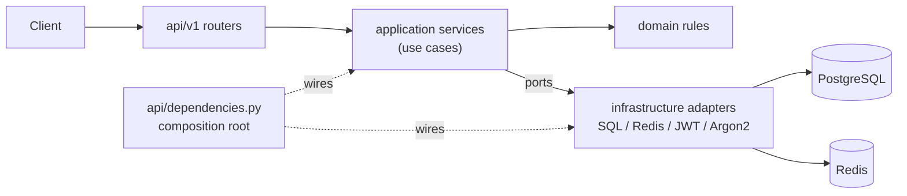
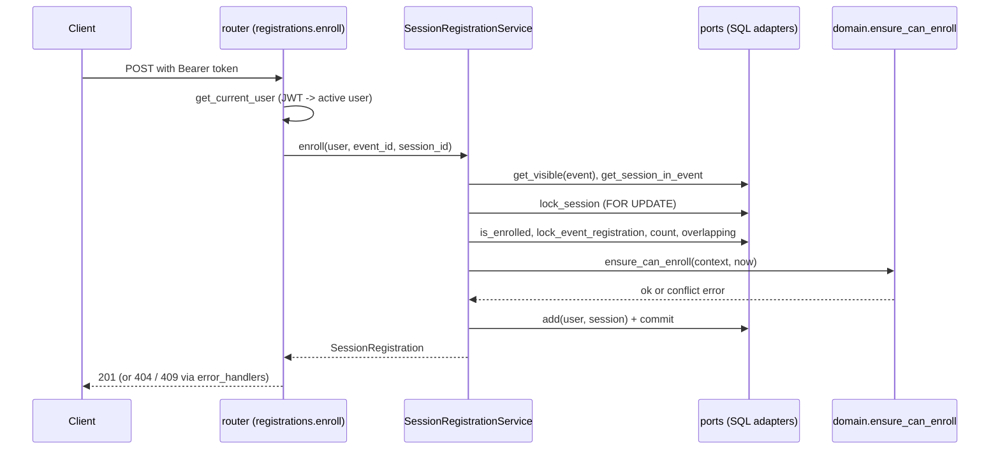

# Backend architecture

The backend (`backend/app`) is a FastAPI service organized as a hexagonal (ports and
adapters) architecture. Business rules live in plain Python and know nothing about HTTP,
SQL or Redis; those are adapters plugged in at one place.

Stack: FastAPI, SQLModel/SQLAlchemy, Alembic, PostgreSQL 16, Redis 7 (optional cache),
Argon2 password hashing and JWT access tokens.

## Layers

| Layer | Path | Responsibility | May import |
| --- | --- | --- | --- |
| Domain | `app/domain` | Entities, value objects and business rules as pure functions (`ensure_can_enroll`, `validate_transition`, ...). | Standard library only |
| Application | `app/application` | Use cases (services), ports (`Protocol`s), cache policies, guards. | Domain |
| Infrastructure | `app/infrastructure` | Adapters: SQL repositories, Unit of Work, Redis/Null cache, JWT, Argon2. | Application, Domain |
| API | `app/api` | HTTP routers, request/response schemas, dependency wiring, error mapping. | Application, Domain, Infrastructure (wiring only) |

`app/core/config.py` holds the environment-driven `Settings`; `app/main.py` builds the
FastAPI app (CORS, routers, exception handlers).

### Dependency rule

Dependencies point inward: `api -> infrastructure -> application -> domain`.

- `app/domain` and `app/application` do not import `fastapi`, `sqlmodel`, `sqlalchemy`
  or `redis` (checked by search at the time of writing; there is no automated import test).
- Use cases receive ports through their constructor, so they run in tests with in-memory
  fakes (`backend/tests/fakes.py`).
- Only `app/api/dependencies.py` imports concrete adapters.

`backend/tests/test_router_structure.py` enforces one more rule: routers contain no
`try/except` and no `isinstance` chains. Errors are translated in one place (see below).



## Ports and adapters

Ports are declared in `app/application/ports.py`; read-side contracts used by the API are
in `app/application/readers.py`.

| Port | Adapter | File |
| --- | --- | --- |
| `UnitOfWork` | `SqlUnitOfWork` | `app/infrastructure/db/unit_of_work.py` |
| `UserRepository` | `SqlUserRepository` | `app/infrastructure/db/user_repository.py` |
| `EventRepository` | `SqlEventRepository` | `app/infrastructure/db/event_repository.py` |
| `SpeakerRepository` | `SqlSpeakerRepository` | `app/infrastructure/db/speaker_repository.py` |
| `SessionRepository` | `SqlSessionRepository` | `app/infrastructure/db/session_repository.py` |
| `RegistrationRepository` | `SqlRegistrationRepository` | `app/infrastructure/db/registration_repository.py` |
| `SessionEnrollmentWriter`, `SessionEnrollmentLock`, `SessionAvailabilityReader`, `SessionParticipantQueries` | `SqlSessionRegistrationRepository` (one class, four ports) | `app/infrastructure/db/session_registration_repository.py` |
| `EventUsageQueries`, `SpeakerUsageQueries` | `SqlEventUsageQueries`, `SqlSpeakerUsageQueries` | `app/infrastructure/db/usage_queries.py` |
| `EventAccess` | `EventAccessPolicy` (application-level policy over `EventRepository`) | `app/application/guards.py` |
| `Cache` | `RedisCache`, `NullCache` | `app/infrastructure/cache/` |
| `PasswordHasher` | `Argon2PasswordHasher` | `app/infrastructure/security/password_hasher.py` |
| `TokenService` | `JwtTokenService` | `app/infrastructure/security/jwt_tokens.py` |

Read-side contracts (`EventLookup`, `EventCatalogue`, `SpeakerDirectory`, `EventSchedule`)
are implemented both by the plain services and by cached decorators in
`app/infrastructure/cache/cached_readers.py`. See [backend-cache.md](backend-cache.md).

Report queries (`report_queries.py`) and the persistence models (`models.py`, mapped to
domain objects by `mappers.py`) are internal to the SQL adapter.

## Unit of Work and transactions

`SqlUnitOfWork` wraps the request-scoped SQLModel `Session` that every repository of the
request shares. Repositories only stage writes; the use case decides when they become
durable with the `transaction()` context manager from `ports.py`:

```python
with transaction(self._uow):      # commit on success, rollback + re-raise on error
    ...                           # rules + repository calls
self._cache.invalidate()          # only after the commit succeeded
```

Cache invalidation always happens after the `with` block, so a rolled-back change never
drops cache entries and a committed one always does.

Concurrency-sensitive writes take row locks (`SELECT ... FOR UPDATE`) inside the
transaction: `RegistrationRepository.lock_event`, `SessionEnrollmentWriter.lock_session`,
`lock_event_registration` and `SessionEnrollmentLock.lock_and_count_enrollments`. A unique
constraint is the last line of defence: its `IntegrityError` becomes `DuplicateEntryError`,
which the use case turns into the matching domain conflict.

## Composition root

`app/api/dependencies.py` is the only place where concrete adapters meet use cases. Each
`get_*` function is a FastAPI dependency:

- `get_session` (in `infrastructure/db/session.py`) yields one `Session` per request.
- `get_unit_of_work`, `get_*_repository` build adapters on that session.
- `get_cache` returns `RedisCache` when `REDIS_URL` is set, `NullCache` otherwise.
- `get_event_service`, `get_session_service`, ... assemble use cases from ports.
- `get_current_user` / `get_optional_user` resolve the bearer token;
  `require_role(...)`, `organizer_or_admin` and `require_admin` are the role guards.

Tests swap any of these with `app.dependency_overrides` (see `backend/tests/conftest.py`).

## Error mapping

Use cases and the domain raise their own exceptions. `app/api/error_handlers.py` keeps a
single table, `ERROR_RESPONSES`, from exception type to HTTP status and message, and
registers one handler for all of them. Subclasses resolve through the MRO.

| Family | Status | Examples |
| --- | --- | --- |
| Not found / not visible | 404 | `EventNotFoundError`, `NotRegisteredError`, `NotEnrolledError` |
| Permission | 403 | `PermissionDeniedError` |
| Validation of business rules | 422 | `EventValidationError`, `SessionValidationError`, `InvalidFullNameError` |
| State or uniqueness conflicts | 409 | `EventStateError`, `EventFullError`, `ScheduleConflictError`, `SelfLockoutError`, `SpeakerInUseError`, `EmailAlreadyRegisteredError` |
| Bad credentials | 401 | `InvalidCredentialsError` (with `WWW-Authenticate: Bearer`) |

Authentication failures from `get_current_user` and role checks from `require_role` raise
`HTTPException` directly (401 and 403). The response body is always `{"detail": "..."}`;
see [backend-api.md](backend-api.md).

## One request, end to end: enroll in a session

`POST /api/v1/events/{event_id}/sessions/{session_id}/register`



1. `get_current_user` decodes the JWT and loads the active user (401 otherwise).
2. `SessionRegistrationService.enroll` (`app/application/session_registration_service.py`)
   opens a `transaction`, checks the event is visible to the user and the session belongs
   to it, and locks the session row so concurrent enrollments serialize.
3. It builds an `EnrollmentContext` and calls the pure rule `ensure_can_enroll`
   (`app/domain/session_registration.py`): event published and not ended, session not ended,
   user registered to the event, no overlapping enrollment, seats left.
4. The row is added; a unique-key race becomes `AlreadyEnrolledError`. Any
   `EnrollmentConflictError` is mapped to 409 by `error_handlers.py`.

The rules themselves are listed in [backend-domain-rules.md](backend-domain-rules.md).

## SOLID in practice

| Principle | Where it shows |
| --- | --- |
| Single responsibility | `EventAccessPolicy` only answers who may see or manage an event; `cache_policy.py` only knows keys, namespaces and TTLs; `report_filenames.py` only builds download names. |
| Open/closed | New cached reads are added as decorators (`CachedEventSchedule`) without touching the services; new error types are one line in `ERROR_RESPONSES`. |
| Liskov | `NullCache` and `RedisCache` are interchangeable behind `Cache`; cached readers are drop-in replacements for the plain services behind `EventCatalogue`, `SpeakerDirectory`, `EventSchedule`. |
| Interface segregation | The enrollment adapter is one class but four narrow ports: `SessionRegistrationService` needs `SessionEnrollmentWriter`, `SessionService` only `SessionEnrollmentLock`, `SessionCatalogue` only `SessionAvailabilityReader`, reports only `SessionParticipantQueries`. |
| Dependency inversion | Services import `ports.py`, never `infrastructure`; `dependencies.py` injects the adapters. |

Other examples:

- `SessionCatalogue` (`app/application/session_catalogue.py`) is a query service: it merges
  the shareable cached schedule with live per-viewer availability, so a cached payload never
  contains viewer-specific data.
- `EventAccess` is a port, so the report services depend on "can manage this event" rather
  than on the event repository.
- Time comes from an injected `Clock` (`app/application/clock.py`), which keeps date rules
  deterministic in tests.
