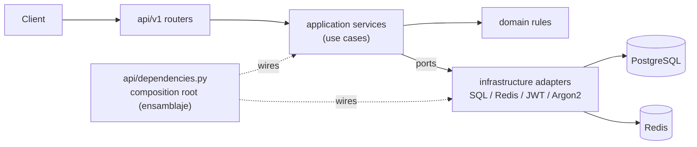
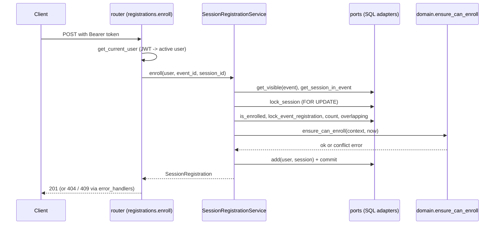

# Arquitectura del backend

El backend (`backend/app`) es un servicio FastAPI organizado con una arquitectura
hexagonal (puertos y adaptadores). Las reglas de negocio no conocen HTTP, bases de datos
ni cache: esas piezas son adaptadores que se conectan entre sí en un único lugar.

Stack: FastAPI, SQLModel/SQLAlchemy, Alembic, PostgreSQL 16, Redis,
hash de contraseñas con Argon2 y tokens de acceso JWT.

## Capas

| Capa | Ruta | Responsabilidad | Puede importar |
| --- | --- | --- | --- |
| Dominio | `app/domain` | Entidades, objetos de valor y reglas de negocio como funciones puras (`ensure_can_enroll`, `validate_transition`, ...). | Solo la biblioteca estándar |
| Aplicación | `app/application` | Casos de uso (servicios), puertos (`Protocol`s), políticas de cache, guardas. | Dominio |
| Infraestructura | `app/infrastructure` | Adaptadores: repositorios SQL, Unit of Work, cache Redis/Null, JWT, Argon2. | Aplicación, Dominio |
| API | `app/api` | Routers HTTP, esquemas de petición/respuesta, cableado de dependencias, mapeo de errores. | Aplicación, Dominio, Infraestructura (solo para el cableado) |

`app/core/config.py` contiene los `Settings` guiados por variables de entorno;
`app/main.py` construye la aplicación FastAPI (CORS, routers, manejadores de excepciones).

### Regla de dependencias

Las dependencias apuntan hacia adentro: `api -> infrastructure -> application -> domain`.

- `app/domain` y `app/application` no importan `fastapi`, `sqlmodel`, `sqlalchemy`
  ni `redis`.
- Los casos de uso reciben los puertos por el constructor, por lo que se ejecutan en las
  pruebas con fakes en memoria (`backend/tests/fakes.py`).
- Solo `app/api/dependencies.py` importa adaptadores concretos.

`backend/tests/test_router_structure.py` hace cumplir una regla más: los routers no
contienen `try/except` ni cadenas de `isinstance`. Los errores se traducen en un solo
lugar (ver más abajo).



## Puertos y adaptadores

Los puertos se declaran en `app/application/ports.py`; los contratos del lado de lectura
que usa la API están en `app/application/readers.py`.

| Puerto | Adaptador | Archivo |
| --- | --- | --- |
| `UnitOfWork` | `SqlUnitOfWork` | `app/infrastructure/db/unit_of_work.py` |
| `UserRepository` | `SqlUserRepository` | `app/infrastructure/db/user_repository.py` |
| `EventRepository` | `SqlEventRepository` | `app/infrastructure/db/event_repository.py` |
| `SpeakerRepository` | `SqlSpeakerRepository` | `app/infrastructure/db/speaker_repository.py` |
| `SessionRepository` | `SqlSessionRepository` | `app/infrastructure/db/session_repository.py` |
| `RegistrationRepository` | `SqlRegistrationRepository` | `app/infrastructure/db/registration_repository.py` |
| `SessionEnrollmentWriter`, `SessionEnrollmentLock`, `SessionAvailabilityReader`, `SessionParticipantQueries` | `SqlSessionRegistrationRepository`| `app/infrastructure/db/session_registration_repository.py` |
| `EventUsageQueries`, `SpeakerUsageQueries` | `SqlEventUsageQueries`, `SqlSpeakerUsageQueries` | `app/infrastructure/db/usage_queries.py` |
| `EventAccess` | `EventAccessPolicy` (política a nivel de aplicación sobre `EventRepository`) | `app/application/guards.py` |
| `Cache` | `RedisCache`, `NullCache` | `app/infrastructure/cache/` |
| `PasswordHasher` | `Argon2PasswordHasher` | `app/infrastructure/security/password_hasher.py` |
| `TokenService` | `JwtTokenService` | `app/infrastructure/security/jwt_tokens.py` |

Los contratos del lado de lectura (`EventLookup`, `EventCatalogue`, `SpeakerDirectory`,
`EventSchedule`) los implementan tanto los servicios simples como los decoradores con
cache de `app/infrastructure/cache/cached_readers.py`. Ver [backend-cache.md](backend-cache.md).

Las consultas de reportes (`report_queries.py`) y los modelos de persistencia
(`models.py`, mapeados a objetos de dominio por `mappers.py`) son internos del adaptador SQL.

## Unidad de trabajo (Unit of Work) y transacciones

`SqlUnitOfWork` envuelve la `Session` de SQLModel con alcance de petición que comparten
todos los repositorios de esa petición. Los repositorios solo preparan las escrituras; el
caso de uso decide cuándo se vuelven definitivas con el gestor de contexto `transaction()`
de `ports.py`:

```python
with transaction(self._uow):      # commit si todo sale bien; rollback y se relanza el error si falla
    ...                           # reglas + llamadas a repositorios
self._cache.invalidate()          # solo después de que el commit tuvo éxito
```

La invalidación del cache siempre ocurre después del bloque `with`, de modo que un cambio
revertido nunca descarta entradas del cache y uno confirmado siempre lo hace.

Las escrituras sensibles a la concurrencia toman bloqueos de fila (`SELECT ... FOR UPDATE`)
dentro de la transacción: `RegistrationRepository.lock_event`,
`SessionEnrollmentWriter.lock_session`, `lock_event_registration` y
`SessionEnrollmentLock.lock_and_count_enrollments`. Una restricción de unicidad es la
última línea de defensa: su `IntegrityError` se convierte en `DuplicateEntryError`, que el
caso de uso transforma en el conflicto de dominio correspondiente.

## Dónde se ensamblan las dependencias

`app/api/dependencies.py` es el único lugar donde los adaptadores concretos se encuentran
con los casos de uso. Cada función `get_*` es una dependencia de FastAPI:

- `get_session` (en `infrastructure/db/session.py`) entrega una `Session` por petición.
- `get_unit_of_work`, `get_*_repository` construyen adaptadores sobre esa sesión.
- `get_cache` devuelve `RedisCache` cuando `REDIS_URL` está definida y `NullCache` en caso
  contrario.
- `get_event_service`, `get_session_service`, ... ensamblan los casos de uso a partir de
  los puertos.
- `get_current_user` / `get_optional_user` resuelven el bearer token;
  `require_role(...)`, `organizer_or_admin` y `require_admin` son las guardas de rol.

Las pruebas reemplazan cualquiera de estas con `app.dependency_overrides` (ver
`backend/tests/conftest.py`).

## Mapeo de errores

Los casos de uso y el dominio lanzan sus propias excepciones. `app/api/error_handlers.py`
mantiene una única tabla, `ERROR_RESPONSES`, del tipo de excepción al estado HTTP y al
mensaje, y registra un solo manejador para todas ellas. Si una excepción no figura en la
tabla, se usa la entrada de su clase padre más cercana.

| Familia | Estado | Ejemplos |
| --- | --- | --- |
| No encontrado / no visible | 404 | `EventNotFoundError`, `NotRegisteredError`, `NotEnrolledError` |
| Permisos | 403 | `PermissionDeniedError` |
| Validación de reglas de negocio | 422 | `EventValidationError`, `SessionValidationError`, `InvalidFullNameError` |
| Conflictos de estado o unicidad | 409 | `EventStateError`, `EventFullError`, `ScheduleConflictError`, `SelfLockoutError`, `SpeakerInUseError`, `EmailAlreadyRegisteredError` |
| Credenciales incorrectas | 401 | `InvalidCredentialsError` (con `WWW-Authenticate: Bearer`) |

Los fallos de autenticación de `get_current_user` y las verificaciones de rol de
`require_role` lanzan `HTTPException` directamente (401 y 403). El cuerpo de la respuesta
siempre es `{"detail": "..."}`; ver [backend-api.md](backend-api.md).

## Una petición de extremo a extremo: inscripción a una sesión

`POST /api/v1/events/{event_id}/sessions/{session_id}/register`



1. `get_current_user` decodifica el JWT y carga al usuario activo (401 en caso contrario).
2. `SessionRegistrationService.enroll` (`app/application/session_registration_service.py`)
   abre una `transaction`, verifica que el evento sea visible para el usuario y que la
   sesión pertenezca a él, y bloquea la fila de la sesión para que las inscripciones
   concurrentes se serialicen.
3. Construye un `EnrollmentContext` y llama a la regla pura `ensure_can_enroll`
   (`app/domain/session_registration.py`): evento publicado y no terminado, sesión no
   terminada, usuario inscrito al evento, sin inscripción solapada, cupos disponibles.
4. Se agrega la fila; una carrera por clave única se convierte en `AlreadyEnrolledError`.
   Cualquier `EnrollmentConflictError` se mapea a 409 en `error_handlers.py`.

Las reglas en sí están listadas en [backend-domain-rules.md](backend-domain-rules.md).

## SOLID en la práctica

| Principio | Dónde se ve |
| --- | --- |
| Responsabilidad única | `EventAccessPolicy` solo responde quién puede ver o gestionar un evento; `cache_policy.py` solo conoce claves, namespaces y TTL; `report_filenames.py` solo construye nombres de descarga. |
| Abierto/cerrado | Las nuevas lecturas con cache se agregan como decoradores (`CachedEventSchedule`) sin tocar los servicios; los nuevos tipos de error son una línea en `ERROR_RESPONSES`. |
| Liskov Substitution | `NullCache` y `RedisCache` son intercambiables detrás de `Cache`; los lectores con cache reemplazan directamente a los servicios simples detrás de `EventCatalogue`, `SpeakerDirectory`, `EventSchedule`. |
| Segregación de interfaces | El adaptador de inscripciones es una clase pero cuatro puertos estrechos: `SessionRegistrationService` necesita `SessionEnrollmentWriter`, `SessionService` solo `SessionEnrollmentLock`, `SessionCatalogue` solo `SessionAvailabilityReader`, y los reportes solo `SessionParticipantQueries`. |
| Inversión de dependencias | Los servicios importan `ports.py`, nunca `infrastructure`; `dependencies.py` inyecta los adaptadores. |

Otros ejemplos:

- `SessionCatalogue` (`app/application/session_catalogue.py`) es un servicio de consulta:
  combina el horario compartible con cache con la disponibilidad en vivo por usuario,
  de modo que un payload cacheado nunca contiene datos específicos de cada usuario.
- `EventAccess` es un puerto, por lo que los servicios de reportes dependen de "puede
  gestionar este evento" en lugar de depender del repositorio de eventos.
- El tiempo proviene de un `Clock` inyectado (`app/application/clock.py`), lo que mantiene
  las reglas de fechas deterministas en las pruebas.
