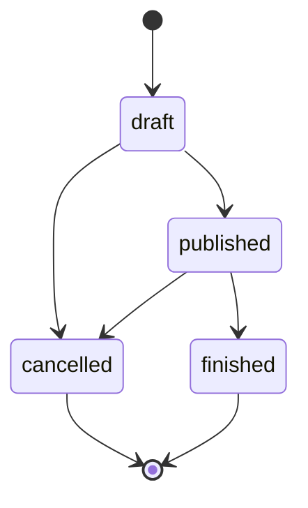

# Reglas de dominio del backend

Reglas de negocio tal como están implementadas. Las reglas puras viven en
`backend/app/domain`; los casos de uso que las aplican están en `backend/app/application`.
Cada regla de abajo está cubierta por pruebas, nombradas junto a ella. Para los códigos de
estado de error ver [backend-api.md](backend-api.md).

## Roles y permisos

Los roles se definen en `app/domain/enums.py`. En la tabla se nombran en español y en el
código, la API y la base de datos sus valores son `attendee` (Asistente), `organizer`
(Organizador) y `admin` (Administrador).
Los "roles organizadores" (`app/domain/roles.py`) son `organizer` y `admin`.

| Capacidad | Anónimo | Asistente | Organizador | Administrador |
| --- | --- | --- | --- | --- |
| Explorar eventos publicados, sesiones y ponentes | sí | sí | sí | sí |
| Ver eventos no publicados | no | no | solo sus eventos | todos |
| Inscribirse a eventos y a sesiones | no | sí | sí | sí |
| Crear eventos y ponentes | no | no | sí | sí |
| Editar, cambiar el estado o eliminar un evento o sus sesiones | no | no | solo sus eventos | todos |
| Editar o eliminar un ponente | no | no | sí (cualquier ponente) | sí |
| Reportes de participantes (JSON y CSV) | no | no | solo sus eventos | todos |
| Listar y editar usuarios | no | no | no | sí |

Detalles:

- El autorregistro (`POST /api/v1/auth/register`) siempre crea un `organizer`; el cliente
  no puede elegir un rol (`AuthService.register`). Solo un admin puede cambiar un rol, y
  los asistentes de demostración provienen del seed de demostración (ver
  [backend-operations.md](backend-operations.md)).
- Las contraseñas requieren al menos 8 caracteres (`app/domain/user.py`); el esquema las
  limita a 128. Los correos se almacenan sin espacios extremos y en minúsculas. Los nombres
  completos se recortan y tienen de 1 a 200 caracteres.
- Una contraseña incorrecta, un correo desconocido y una cuenta desactivada responden el
  mismo 401, de modo que el inicio de sesión no revela qué cuentas existen. Un correo
  desconocido igualmente gasta un cálculo de hash para atenuar las diferencias de tiempo.
- Los usuarios desactivados (`is_active = false`) no pueden iniciar sesión y sus tokens
  existentes dejan de funcionar, porque `AuthService.authenticate` vuelve a leer al usuario
  en cada petición.
- La propiedad se verifica en `EventAccessPolicy.ensure_can_manage`
  (`app/application/guards.py`): admin, o `event.organizer_id == actor.id`.

Pruebas: `test_auth_service.py`, `test_auth_api.py`, `test_event_service.py`,
`test_events_api.py`.

## Ciclo de vida del evento

Estados: `draft` (por defecto), `published`, `cancelled`, `finished`.
Transiciones permitidas (`ALLOWED_TRANSITIONS` en `app/domain/event.py`):

- `cancelled` y `finished` son finales: no hay transición de salida ni ediciones
  (`ensure_editable` lanza un 409).
- Cualquier otra transición responde 409 (`validate_transition`).
- `published -> finished` es manual o la hace el script `close_past_events`
  (ver [backend-scripts.md](backend-scripts.md)); nada lo ejecuta automáticamente.

### Visibilidad

`can_view` (`app/domain/event.py`): un evento `published` es público; cualquier otro estado
es visible solo para su organizador y para los administradores. Para todos los demás
responde 404, exactamente igual que un evento inexistente. En los listados, los usuarios
anónimos y los asistentes ven solo los eventos publicados, los organizadores suman sus
propios eventos en cualquier estado y los administradores ven todos (`EventService.list`).

### Creación y edición

- `start_at` debe estar en el futuro al crear; `end_at` debe ser posterior a `start_at`;
  `capacity` al menos 1 (`EventValidationError`, 422). La base de datos repite estas
  reglas como restricciones `CHECK` (`ck_event_capacity_positive`, `ck_event_dates_order`).
- Actualizar un evento también requiere (409, `EventStateError`):
  - capacidad no menor que la mayor capacidad de sus sesiones;
  - capacidad no menor que las inscripciones actuales al evento;
  - nuevas fechas que sigan conteniendo todas las sesiones existentes.
- Eliminar un evento elimina sus sesiones, inscripciones e inscripciones a sesiones mediante
  `ON DELETE CASCADE` (`app/infrastructure/db/models.py`).

Pruebas: `test_event_domain.py`, `test_event_service.py`, `test_events_api.py`.

## Inscripciones (a nivel de evento)

Una inscripción es un usuario en un evento, única por `(user_id, event_id)`
(`uq_registration_user_event`).

Inscribirse (`RegistrationService.register`, `ensure_can_register`):

1. El evento debe ser visible para el usuario; de lo contrario, 404.
2. El usuario no debe estar ya inscrito (409 `AlreadyRegisteredError`).
3. El evento está `published` (409 en caso contrario), no ha terminado (409) y tiene cupos
   disponibles (409 `EventFullError`).

La fila del evento se bloquea (`FOR UPDATE`) mientras se cuenta, de modo que el último cupo
nunca se sobrevende bajo concurrencia; una carrera por clave única se mapea al mismo
conflicto de "ya inscrito".

Cancelar (`RegistrationService.cancel`):

- Solo se puede cancelar una inscripción existente (404 `NotRegisteredError`).
- No está permitido una vez que el evento está `finished` (409). Está permitido para
  eventos `cancelled`.
- También elimina las inscripciones del usuario a las sesiones de ese evento (cascada).

Pruebas: `test_registration_service.py`, `test_registrations_api.py`,
`test_registration_concurrency_postgres.py`.

## Inscripciones a sesiones (por sesión)

Una sesión pertenece a un evento y tiene su propia capacidad y un ponente. Para inscribirse
primero se necesita la inscripción al evento.

`ensure_can_enroll` (`app/domain/session_registration.py`) verifica, en este orden:

1. El evento está `published` (409 `EnrollmentClosedError`).
2. El evento no ha terminado, y la sesión no ha terminado.
3. El usuario está inscrito al evento (409 `EventRegistrationRequiredError`).
4. No hay solapamiento con otra sesión a la que el usuario esté inscrito (409
   `ScheduleConflictError`). Los intervalos son semiabiertos: las sesiones consecutivas no
   se solapan.
5. La sesión tiene cupos disponibles (409 `SessionFullError`).

Además: estar ya inscrito es 409 `AlreadyEnrolledError`, y una sesión que no pertenece al
evento es 404. La fila de la sesión se bloquea durante la verificación, de modo que las
inscripciones concurrentes no pueden exceder la capacidad.

Cancelar una inscripción a sesión: 404 `NotEnrolledError` cuando no existe; 409 cuando el
evento está `finished`.

La disponibilidad (`enrolled_count`, `available_spots`, `is_enrolled`) la lee en vivo en
cada petición `SessionCatalogue`, nunca desde el cache.

Pruebas: `test_session_registration_domain.py`, `test_session_registration_service.py`,
`test_session_registrations_api.py`, `test_session_registration_concurrency_postgres.py`.

## Sesiones y ponentes

Reglas de sesión (`app/domain/session.py`, `app/application/session_service.py`):

- Solo el organizador del evento o un admin puede crear, actualizar o eliminar sesiones, y
  solo mientras el evento está `draft` o `published`.
- La sesión debe estar dentro de las fechas del evento, terminar después de empezar, tener
  capacidad de al menos 1 y no mayor que la capacidad del evento, y referenciar un ponente
  existente (422).
- Un ponente no puede tener dos sesiones solapadas en ningún evento (409
  `SessionConflictError`); la sesión que se está actualizando se ignora en esa verificación.
- Guardas cuando la sesión ya tiene inscripciones (409 `SessionStateError`): su capacidad
  no puede bajar del número de inscritos, su horario no puede cambiar y no se puede
  eliminar. La verificación se ejecuta bajo el bloqueo de la fila de la sesión.

Reglas de ponente (`app/application/speaker_service.py`):

- Los ponentes son un directorio compartido, no pertenecen a un evento. Cualquier
  organizador o admin puede crearlos, editarlos o eliminarlos; la lectura es pública.
- `email` es opcional, se almacena sin espacios extremos y en minúsculas, y es único cuando
  está presente (409).
- Un ponente con sesiones no se puede eliminar (409 `SpeakerInUseError`).

Pruebas: `test_session_domain.py`, `test_session_service.py`, `test_sessions_api.py`,
`test_speaker_service.py`, `test_speakers_api.py`.

## Reportes y CSV

Dos reportes comparten las mismas reglas (`app/application/report_service.py`):
participantes por inscripción al evento y participantes por inscripción a sesión.

- Roles: organizer o admin; los asistentes reciben 403. Los organizadores están limitados a
  sus propios eventos; un `event_id` o `session_id` ajeno es 403 y uno desconocido es 404.
- Los filtros se combinan con AND: `event_id`, `session_id` (reporte de sesiones), `q`,
  `status` (estado del evento), `date_from` y `date_to`.
- Las fechas son días UTC completos, ambos extremos inclusivos, aplicados al inicio del
  evento (reporte de inscripciones) o al inicio de la sesión (reporte de sesiones).
  `date_to` anterior a `date_from` es 422.
- `q` es una subcadena, sin distinguir mayúsculas, del nombre del evento; en el reporte de
  sesiones también del título de la sesión. No se buscan nombres ni correos de participantes.
- La vista previa JSON está paginada. Las variantes `.csv` entregan en streaming todo el
  resultado en el mismo orden, sin cargarlo en memoria (`app/api/csv_export.py`).

Formato del CSV: UTF-8 con BOM, `;` como delimitador, fin de línea `\r\n`, encabezados en
español. Las celdas que empiezan con `=`, `+`, `-`, `@`, tabulación o retorno de carro
llevan un `'` inicial para que las hojas de cálculo no las ejecuten como fórmulas. La
respuesta tiene `Content-Disposition: attachment` y `Cache-Control: no-store`. Nombres de
archivo (`app/application/report_filenames.py`): `participantes_evento_<id>.csv` o
`participantes_<YYYYMMDD>.csv`, y `participantes_sesion_<id>.csv` o
`participantes_sesiones_<YYYYMMDD>.csv`.

Pruebas: `test_report_service.py`, `test_session_report_service.py`, `test_reports_api.py`,
`test_session_reports_api.py`, `test_csv_export.py`, `test_report_filenames.py`.

## Administración de usuarios

Solo admin (`/api/v1/admin/users`).

- El listado está paginado, ordenado por id, con una búsqueda opcional por prefijo de
  `email`: sin distinguir mayúsculas, los comodines se interpretan literalmente y un valor
  en blanco significa sin filtro. Lo sirve el índice de expresión
  `ix_users_email_lower_prefix` (`lower(email) text_pattern_ops`, migración
  `0006_user_email_prefix_index.py`).
- `PATCH` es parcial y necesita al menos uno de `full_name`, `email`, `role`, `is_active`.
  Un correo nuevo no debe pertenecer a otro usuario (409). Los tokens ya emitidos siguen
  siendo válidos tras un cambio de correo porque llevan el id del usuario.
- Regla de autobloqueo (`UserAdminService.update_user`): un admin no puede cambiar su
  propio rol a nada distinto de `admin`, ni desactivarse a sí mismo (409). Sí puede editar
  su propio nombre y correo; el resto lo tiene que hacer otro admin.

Pruebas: `test_admin_user_search.py`, `test_auth_service.py`, `test_user_repository.py`.
