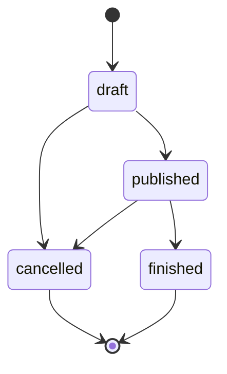

# Backend domain rules

Business rules as implemented. Pure rules live in `backend/app/domain`; the use cases that
apply them are in `backend/app/application`. Every rule below is covered by tests, named
next to it. For error status codes see [backend-api.md](backend-api.md).

## Roles and permissions

Roles are defined in `app/domain/enums.py`: `admin`, `organizer`, `attendee`.
"Organizing roles" (`app/domain/roles.py`) are `organizer` and `admin`.

| Capability | Anonymous | Attendee | Organizer | Admin |
| --- | --- | --- | --- | --- |
| Browse published events, sessions and speakers | yes | yes | yes | yes |
| See non-published events | no | no | own events only | all |
| Register to events and enroll in sessions | no | yes | yes | yes |
| Create events, speakers | no | no | yes | yes |
| Edit, change status, delete an event or its sessions | no | no | own events only | all |
| Edit or delete a speaker | no | no | yes (any speaker) | yes |
| Participant reports (JSON and CSV) | no | no | own events only | all |
| List and edit users | no | no | no | yes |

Details:

- Self-registration (`POST /api/v1/auth/register`) always creates an `organizer`; the
  client cannot choose a role (`AuthService.register`). Only an admin can change a role,
  and demo attendees come from the demo seed (see [backend-operations.md](backend-operations.md)).
- Passwords need at least 8 characters (`app/domain/user.py`); the schema caps them at 128.
  Emails are stored trimmed and lowercase. Full names are trimmed, 1 to 200 characters.
- A wrong password, an unknown email and a deactivated account all answer the same 401, so
  the login does not reveal which accounts exist. An unknown email still spends a hash
  computation to blunt timing differences.
- Deactivated users (`is_active = false`) cannot log in and their existing tokens stop
  working, because `AuthService.authenticate` re-reads the user on every request.
- Ownership is checked in `EventAccessPolicy.ensure_can_manage` (`app/application/guards.py`):
  admin, or `event.organizer_id == actor.id`.

Tests: `test_auth_service.py`, `test_auth_api.py`, `test_event_service.py`,
`test_events_api.py`.

## Event lifecycle

Statuses: `draft` (default), `published`, `cancelled`, `finished`.
Allowed transitions (`ALLOWED_TRANSITIONS` in `app/domain/event.py`):

- `cancelled` and `finished` are final: no transition out and no edits
  (`ensure_editable` raises a 409).
- Any other transition answers 409 (`validate_transition`).
- `published -> finished` is manual or done by the `close_past_events` script
  (see [backend-scripts.md](backend-scripts.md)); nothing runs it automatically.

### Visibility

`can_view` (`app/domain/event.py`): a `published` event is public; any other status is
visible only to its organizer and to admins. For everyone else it answers 404, exactly like
a missing event. In lists, anonymous users and attendees see only published events,
organizers add their own events in any status, admins see all (`EventService.list`).

### Creating and editing

- `start_at` must be in the future when creating; `end_at` must be after `start_at`;
  `capacity` at least 1 (`EventValidationError`, 422). The database repeats these as
  `CHECK` constraints (`ck_event_capacity_positive`, `ck_event_dates_order`).
- Updating an event also requires (409, `EventStateError`):
  - capacity not below the largest session capacity;
  - capacity not below the current event registrations;
  - new dates that still contain every existing session.
- Deleting an event removes its sessions, registrations and enrollments through
  `ON DELETE CASCADE` (`app/infrastructure/db/models.py`).

Tests: `test_event_domain.py`, `test_event_service.py`, `test_events_api.py`.

## Registrations (event level)

A registration is one user in one event, unique per `(user_id, event_id)`
(`uq_registration_user_event`).

Registering (`RegistrationService.register`, `ensure_can_register`):

1. The event must be visible to the user, otherwise 404.
2. The user must not already be registered (409 `AlreadyRegisteredError`).
3. Event is `published` (409 otherwise), has not ended (409), and has seats left (409
   `EventFullError`).

The event row is locked (`FOR UPDATE`) while counting, so the last seat is never oversold
under concurrency; a unique-key race is mapped to the same "already registered" conflict.

Cancelling (`RegistrationService.cancel`):

- Only an existing registration can be cancelled (404 `NotRegisteredError`).
- Not allowed once the event is `finished` (409). Allowed for `cancelled` events.
- It also deletes the user's enrollments in that event's sessions (cascade).

Tests: `test_registration_service.py`, `test_registrations_api.py`,
`test_registration_concurrency_postgres.py`.

## Session enrollments (per session)

A session belongs to an event and has its own capacity and one speaker. Enrolling needs the
event registration first.

`ensure_can_enroll` (`app/domain/session_registration.py`) checks, in this order:

1. The event is `published` (409 `EnrollmentClosedError`).
2. The event has not ended, and the session has not ended.
3. The user is registered to the event (409 `EventRegistrationRequiredError`).
4. No overlap with another session the user is enrolled in (409 `ScheduleConflictError`).
   Intervals are half-open: back-to-back sessions do not overlap.
5. The session has seats left (409 `SessionFullError`).

Plus: already enrolled is 409 `AlreadyEnrolledError`, and a session that does not belong
to the event is 404. The session row is locked during the check, so concurrent enrollments
cannot exceed capacity.

Cancelling an enrollment: 404 `NotEnrolledError` when there is none; 409 when the event is
`finished`.

Availability (`enrolled_count`, `available_spots`, `is_enrolled`) is read live on each
request by `SessionCatalogue`, never from the cache.

Tests: `test_session_registration_domain.py`, `test_session_registration_service.py`,
`test_session_registrations_api.py`, `test_session_registration_concurrency_postgres.py`.

## Sessions and speakers

Session rules (`app/domain/session.py`, `app/application/session_service.py`):

- Only the event's organizer or an admin can create, update or delete sessions, and only
  while the event is `draft` or `published`.
- The session must be inside the event dates, end after it starts, have capacity of at
  least 1 and not above the event capacity, and reference an existing speaker (422).
- A speaker cannot have two overlapping sessions across any events (409
  `SessionConflictError`); the session being updated is ignored in that check.
- Guards when the session already has enrollments (409 `SessionStateError`): its
  capacity cannot go below the enrollment count, its schedule cannot change, and it cannot
  be deleted. The check runs under the session row lock.

Speaker rules (`app/application/speaker_service.py`):

- Speakers are a shared directory, not owned by an event. Any organizer or admin can
  create, edit or delete them; reading is public.
- `email` is optional, stored trimmed and lowercase, and unique when present (409).
- A speaker with sessions cannot be deleted (409 `SpeakerInUseError`).

Tests: `test_session_domain.py`, `test_session_service.py`, `test_sessions_api.py`,
`test_speaker_service.py`, `test_speakers_api.py`.

## Reports and CSV

Two reports share the same rules (`app/application/report_service.py`): participants by
event registration, and participants by session enrollment.

- Roles: organizer or admin; attendees get 403. Organizers are scoped to their own events;
  a foreign `event_id` or `session_id` is 403 and an unknown one is 404.
- Filters combine with AND: `event_id`, `session_id` (session report), `q`, `status`
  (event status), `date_from` and `date_to`.
- Dates are whole UTC days, both inclusive, applied to the event start (registrations
  report) or the session start (sessions report). `date_to` before `date_from` is 422.
- `q` is a case-insensitive substring of the event name; in the session report also of the
  session title. Participant names and emails are not searched.
- The JSON preview is paginated. The `.csv` variants stream the whole result in the same
  order, without loading it in memory (`app/api/csv_export.py`).

CSV format: UTF-8 with BOM, `;` as delimiter, `\r\n` line endings, Spanish headers. Cells
starting with `=`, `+`, `-`, `@`, tab or carriage return get a leading `'` so spreadsheets
do not execute them as formulas. The response has `Content-Disposition: attachment` and
`Cache-Control: no-store`. File names (`app/application/report_filenames.py`):
`participantes_evento_<id>.csv` or `participantes_<YYYYMMDD>.csv`, and
`participantes_sesion_<id>.csv` or `participantes_sesiones_<YYYYMMDD>.csv`.

Tests: `test_report_service.py`, `test_session_report_service.py`, `test_reports_api.py`,
`test_session_reports_api.py`, `test_csv_export.py`, `test_report_filenames.py`.

## User administration

Admin only (`/api/v1/admin/users`).

- Listing is paginated, ordered by id, with an optional `email` prefix search:
  case-insensitive, wildcard characters matched literally, blank means no filter. It is
  served by the expression index `ix_users_email_lower_prefix`
  (`lower(email) text_pattern_ops`, migration `0006_user_email_prefix_index.py`).
- `PATCH` is partial and needs at least one of `full_name`, `email`, `role`, `is_active`.
  A new email must not belong to another user (409). Tokens already issued stay valid after
  an email change because they carry the user id.
- Self-lockout rule (`UserAdminService.update_user`): an admin cannot change their own role
  to anything but `admin`, nor deactivate themselves (409). They may edit their own name and
  email; another admin has to do the rest.

Tests: `test_admin_user_search.py`, `test_auth_service.py`, `test_user_repository.py`.
