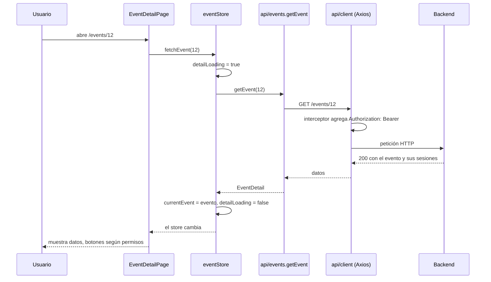

# Arquitectura del frontend

El frontend (`frontend/`) es una aplicación de una sola página (SPA) hecha con React,
TypeScript y Vite. Corre en el navegador y habla con el backend por HTTP. No hay servidor
de aplicación propio: en producción solo se sirven archivos estáticos (ver
[frontend-operations.md](frontend-operations.md)).

Stack: React 18, React Router 6, Zustand (estado global), Axios (HTTP) y CSS Modules.

## Mapa de `frontend/src`

| Carpeta / archivo | Qué vive ahí |
| --- | --- |
| `main.tsx` | Punto de entrada: monta `App` y carga `styles/tokens.css` |
| `App.tsx` | Restaura la sesión al arrancar (`hydrate()`) y monta el router |
| `routes/` | Tabla de rutas (`index.tsx`) y la guarda `ProtectedRoute.tsx` |
| `pages/` | Una página por pantalla (`EventListPage`, `EventDetailPage`, ...) |
| `components/` | Piezas reutilizables: `Button`, `Input`, `Toast`, `Navbar`, formularios, ... |
| `api/` | Una función por endpoint del backend, agrupadas por recurso (`events.ts`, `sessions.ts`, ...), sobre el cliente de `client.ts` |
| `store/` | Estado global con Zustand: `authStore` (sesión), `eventStore` (eventos), `toastStore` (avisos) |
| `i18n/` | Todos los textos visibles en español (`es.ts`) y helpers como `statusLabel` |
| `utils/` | Funciones puras: permisos (`permissions.ts`), validaciones (`*Validation.ts`, `validation.ts`), formato de fechas (`format.ts`) |
| `types/index.ts` | Tipos TypeScript que reflejan las respuestas y payloads del backend |
| `styles/tokens.css` | Variables CSS globales (colores, espacios, radios) |
| `test/setup.ts` | Preparación común de las pruebas Vitest |

Las pruebas viven junto al archivo que prueban (`Button.tsx` y `Button.test.tsx`).

### Regla de dependencias

Las páginas usan componentes, stores y `api/`. Por lo general los componentes reciben datos
y callbacks por props y la página hace la llamada; las excepciones son `SpeakerPicker`
(lista ponentes) y `UserEditForm` (actualiza usuarios), que llaman a `api/` directamente.
`api/` y `utils/` no importan componentes ni páginas.

## Una pantalla de extremo a extremo: detalle de un evento

Ruta `/events/:id`, página `pages/EventDetailPage.tsx`.

1. La página lee el `id` de la URL y llama a `fetchEvent(id)` dentro de un `useEffect`.
2. `useEventStore` (`store/eventStore.ts`) marca `detailLoading`, llama a `getEvent` de
   `api/events.ts` y guarda el resultado en `currentEvent`. Si responden dos peticiones
   fuera de orden, solo la más reciente escribe en el store.
3. La página decide qué mostrar: `Spinner` mientras carga, `ErrorMessage` si falló o el id
   no es válido, y el contenido si hay evento.
4. Los botones dependen de funciones de `utils/permissions.ts` (`canManageEvent`,
   `nextStatuses`, `isEditableStatus`, `canCancelRegistration`). El backend sigue siendo
   la autoridad: si el usuario logra enviar algo no permitido, responderá 403 o 409.
5. Una acción (inscribirse, cambiar estado, borrar una sesión) pasa por la función `run`
   de la página: ejecuta la llamada, muestra un `toast` de éxito o error y vuelve a pedir
   el evento para refrescar la pantalla.

## Rutas y protección por rol

Las rutas se declaran en `routes/index.tsx`. Cada página se carga bajo demanda
(`lazy`) y todas cuelgan de `Layout`, que pinta `Navbar`, la página activa y los avisos.

| Ruta | Página | Acceso |
| --- | --- | --- |
| `/` | `EventListPage` | Público |
| `/events/:id` | `EventDetailPage` | Público (inscribirse requiere sesión) |
| `/login`, `/register` | `LoginPage`, `RegisterPage` | Público |
| `/events/new`, `/events/:id/edit` | `EventFormPage` | Sesión iniciada; luego organizador o admin |
| `/speakers/new` | `SpeakerFormPage` | Sesión iniciada; luego organizador o admin |
| `/profile` | `ProfilePage` | Sesión iniciada |
| `/reports` | `ReportsPage` | Sesión iniciada; luego organizador o admin |
| `/admin/users` | `AdminUsersPage` | Sesión iniciada; luego admin |
| `*` | `NotFoundPage` | Público |

La protección tiene dos niveles:

| Nivel | Dónde | Qué hace |
| --- | --- | --- |
| Sesión | `routes/ProtectedRoute.tsx` | Si no hay token, redirige a `/login` y recuerda la ubicación pedida para volver después del login |
| Rol | Dentro de cada página, con `utils/permissions.ts` | Si el rol no alcanza, la página muestra un `ErrorMessage` en lugar del contenido |

`Navbar` usa las mismas funciones (`canCreateEvents`, `canViewReports`, `isAdmin`) para
ocultar enlaces que el usuario no puede usar. Ocultar un enlace es comodidad, no seguridad:
las reglas reales las aplica el backend (ver [backend-domain-rules.md](backend-domain-rules.md)).

## Sesión

| Pieza | Comportamiento |
| --- | --- |
| Token | Se guarda en `localStorage` con la clave `auth_token` (`TOKEN_STORAGE_KEY` en `store/authStore.ts`). Si el almacenamiento no está disponible, la sesión simplemente no sobrevive a una recarga |
| `login` | Pide el token a `api/auth.ts`, lo guarda y carga el perfil con `loadMe()` |
| `register` | Crea el usuario y hace `login` enseguida, porque la API no devuelve token al registrar |
| `hydrate()` | `App.tsx` lo llama una vez al arrancar: si hay token, carga el perfil; si falla, cierra la sesión |
| `logout` | Borra el token y el usuario |

Después de recargar la página hay un instante con token pero sin `user`; por eso las
páginas con control de rol muestran un `Spinner` mientras `user` es `null` (por ejemplo
`SpeakerFormPage`).

## Cliente HTTP y errores en español

Todas las llamadas usan una única instancia de Axios, `apiClient`, en `api/client.ts`:

- La URL base sale de `VITE_API_URL`; si no está definida usa `http://localhost:8000/api/v1`.
- El interceptor de petición agrega `Authorization: Bearer <token>` cuando hay sesión.
- El interceptor de respuesta convierte cualquier error en un `ApiError` con un mensaje en
  español (función `normalizeError`) y, si el estado es 401, cierra la sesión.

El backend responde los errores en inglés (`{"detail": "..."}`, ver
[backend-api.md](backend-api.md)). `normalizeError` los traduce así:

| Tipo de error del backend | Cómo se traduce | Dónde está el texto |
| --- | --- | --- |
| `detail` fijo, como `Event not found` | Búsqueda exacta en `known` | `messages.errors.known` en `i18n/es.ts` |
| `detail` con valores, como `capacity cannot exceed the event capacity (50)` | Expresión regular que extrae los valores y los pasa a una función | `patterns` en `api/client.ts`, funciones en `i18n/es.ts` |
| Error 422 de validación (lista de campos) | Una frase por campo, según su `type` | `messages.errors.validation` y `messages.fields` |
| Sin respuesta del servidor | Mensaje de red | `messages.common.networkError` |
| Cualquier otro caso | Mensaje genérico | `messages.common.genericError` |

`messages` es el diccionario activo, el mismo objeto que `es` (`messages = locales['es']`
en `i18n/index.ts`).

Para que un error nuevo del backend se vea en español, agrega su texto exacto a
`errors.known` en `i18n/es.ts`. Si no está, el usuario ve el mensaje genérico.

Las páginas capturan el `ApiError` y muestran `error.message` con `toast.error(...)` o
`ErrorMessage`; no necesitan traducir nada.
