# Pantallas de la aplicación

## Índice

| Pantalla | Ruta | Archivo de imagen |
| --- | --- | --- |
| [Registro de cuenta](#registro-de-cuenta) | `/register` | `docs/images/register.png` |
| [Inicio de sesión](#inicio-de-sesión) | `/login` | `docs/images/login.png` |
| [Listado de eventos](#listado-de-eventos) | `/` | `docs/images/event-list.png` |
| [Detalle del evento](#detalle-del-evento) | `/events/:id` | `docs/images/event-detail.png` |
| [Detalle del evento, vista de gestión](#detalle-del-evento-vista-de-gestión) | `/events/:id` | `docs/images/event-detail-manage.png` |
| [Formulario de evento](#formulario-de-evento) | `/events/new` y `/events/:id/edit` | `docs/images/event-form.png` |
| [Formulario de ponente](#formulario-de-ponente) | `/speakers/new` | `docs/images/speaker-form.png` |
| [Mis eventos](#mis-eventos) | `/profile` | `docs/images/profile.png` |
| [Reportes](#reportes) | `/reports` | `docs/images/reports.png` |
| [Administración de usuarios](#administración-de-usuarios) | `/admin/users` | `docs/images/admin-users.png` |
| [Página no encontrada](#página-no-encontrada) | cualquier ruta desconocida (`*`) | `docs/images/page-not-found.png` |
| [Barra de navegación, anónimo](#barra-de-navegación-anónimo) | todas las páginas | `docs/images/navbar-without-sesion.png` |
| [Barra de navegación, organizador](#barra-de-navegación-organizador) | todas las páginas | `docs/images/navbar-with-sesion-org.png` |
| [Móvil: listado de eventos](#móvil-listado-de-eventos) | `/` en ancho de teléfono | `docs/images/event-list-mb.png` |
| [Móvil: detalle del evento](#móvil-detalle-del-evento) | `/events/:id` en ancho de teléfono | `docs/images/event-detail-mb.png` |

## Registro de cuenta

**Ruta:** `/register`

Formulario de creación de cuenta (nombre, correo, contraseña y confirmación). Público. Las cuentas nuevas reciben el rol de organizador.

> 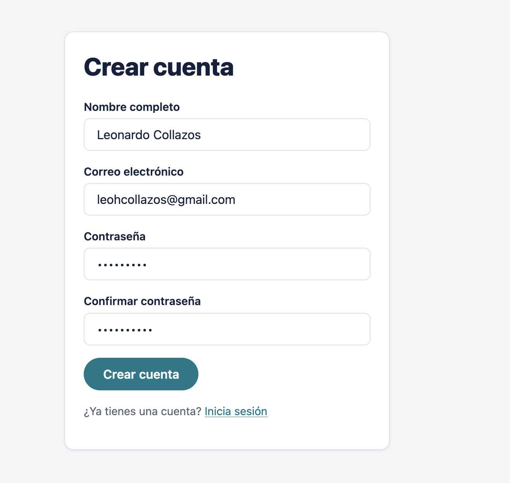

## Inicio de sesión

**Ruta:** `/login`

Formulario de correo y contraseña. Público. Tras iniciar sesión devuelve al usuario a la página de la que venía.

> 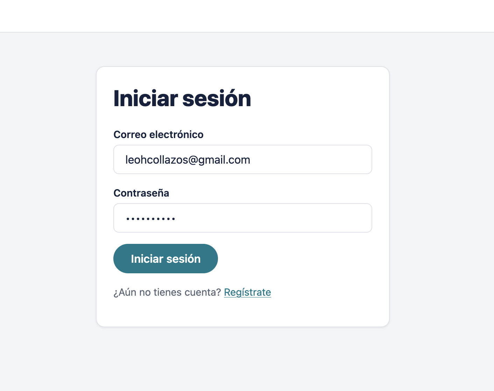

## Listado de eventos

**Ruta:** `/`

Cuadrícula de tarjetas de eventos con búsqueda y paginación (9 por página) y una insignia de estado. Público; los organizadores y administradores también ven los eventos no publicados según su rol.

> 

## Detalle del evento

**Ruta:** `/events/:id`

Información del evento, insignia de estado, cupos disponibles, el botón de inscribirse/cancelar y la lista de sesiones con la inscripción a cada sesión. La lectura es pública; inscribirse requiere iniciar sesión.

> 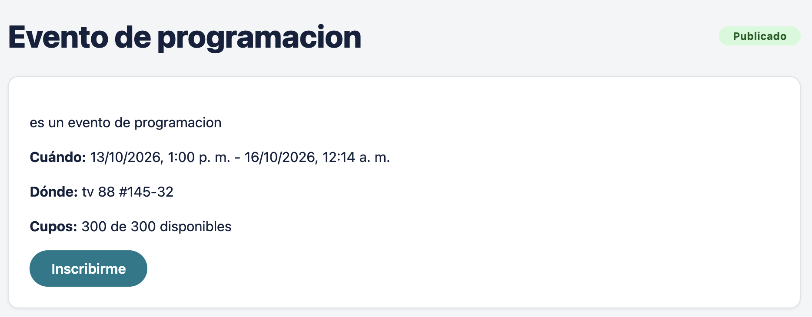

## Detalle del evento, vista de gestión

**Ruta:** `/events/:id`

La misma página para el organizador del evento o un administrador: enlace de edición, cambio de estado, descarga del CSV de participantes, eliminación y los controles para agregar, editar y eliminar sesiones.

> 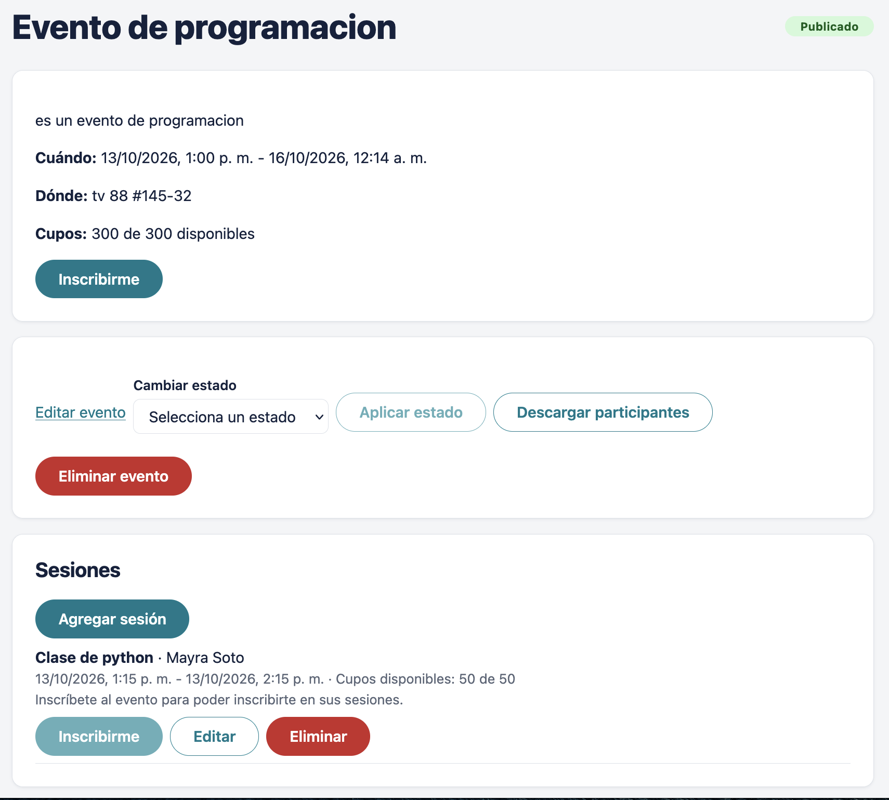

## Formulario de evento

**Ruta:** `/events/new` y `/events/:id/edit`

Crear o editar un evento (nombre, descripción, lugar, fechas, capacidad). Organizadores y administradores; la edición se limita al organizador del evento o a un administrador, y solo mientras el evento no esté cancelado ni finalizado.

> 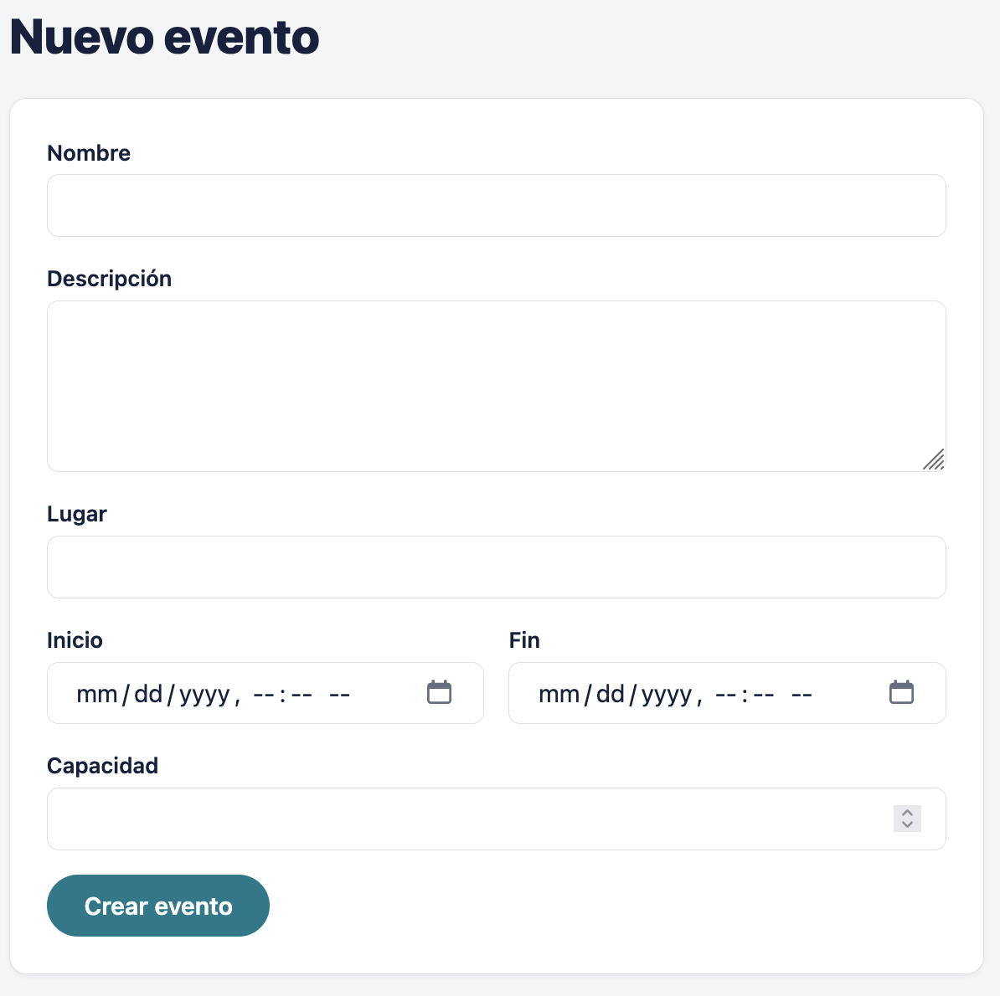

## Formulario de ponente

**Ruta:** `/speakers/new`

Agregar un ponente (nombre, biografía, correo opcional) al directorio compartido. Organizadores y administradores.

> 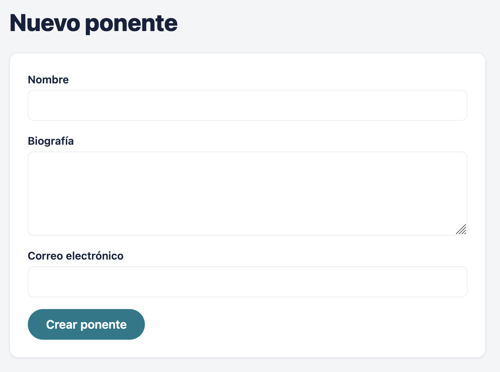

## Mis eventos

**Ruta:** `/profile`

El resumen del perfil del usuario con sesión iniciada y los eventos a los que está inscrito, con una acción para cancelar. Cualquier usuario con sesión iniciada.

> 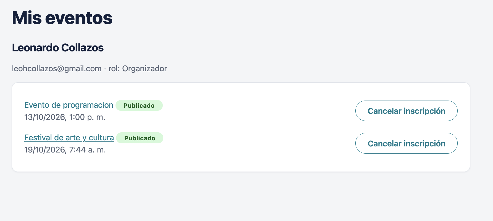

## Reportes

**Ruta:** `/reports`

Vista previa de participantes por evento o por sesión, con búsqueda, filtros de estado y de fecha, paginación y descarga en CSV. Organizadores (sus propios eventos) y administradores; los demás roles ven un mensaje de acceso no permitido.

> 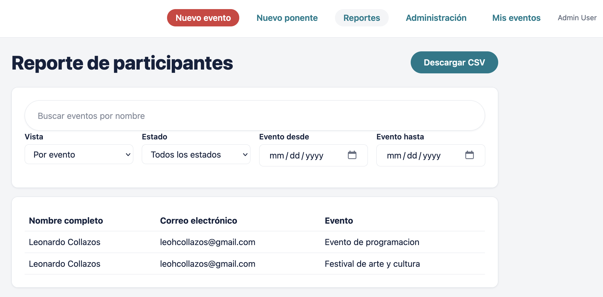

## Administración de usuarios

**Ruta:** `/admin/users`

Búsqueda por prefijo de correo sobre las cuentas de usuario, con edición en línea de nombre, correo, rol e indicador de activo. Solo administradores; los demás roles ven un mensaje de acceso no permitido.

> 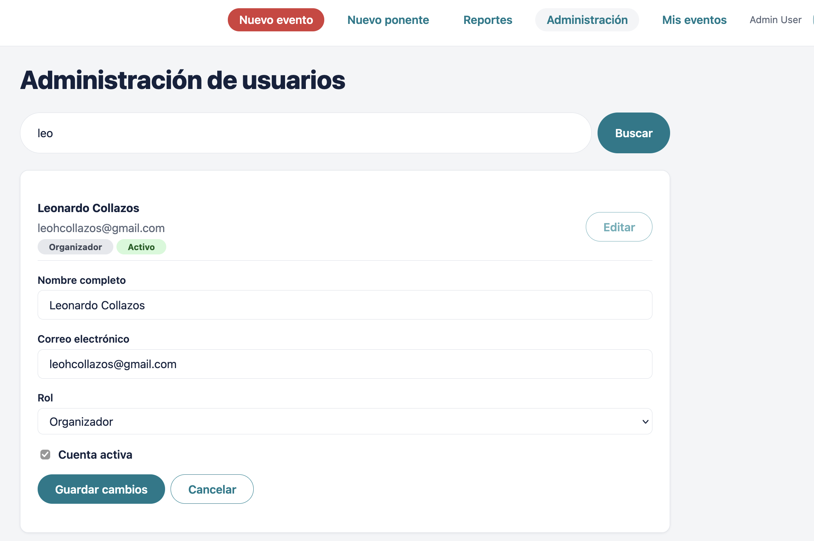

## Página no encontrada

**Ruta:** cualquier ruta desconocida (`*`)

Mensaje y enlace de regreso a la página de inicio. Público.

> 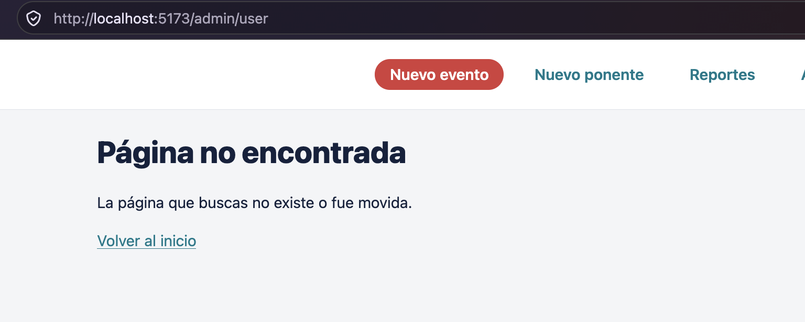

## Barra de navegación, anónimo

**Ruta:** todas las páginas

Enlace de la marca más los enlaces de inicio de sesión y registro. Se muestra a los visitantes sin sesión.

> 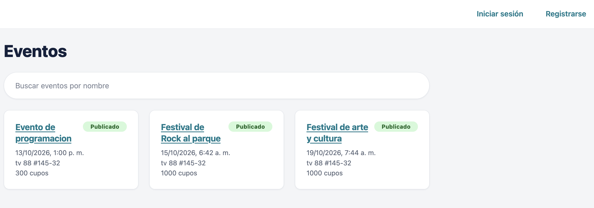

## Barra de navegación, organizador

**Ruta:** todas las páginas

Muestra Nuevo evento, Nuevo ponente, Reportes y Mis eventos, el nombre del usuario y Cerrar sesión. Los administradores también ven Administración.

> 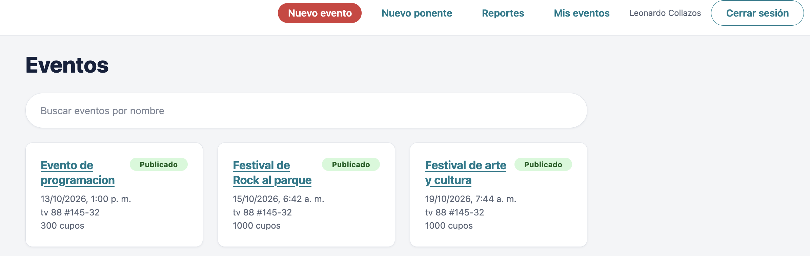

## Móvil: listado de eventos

**Ruta:** `/` en ancho de teléfono

El listado de eventos por debajo del punto de corte de 640 px, donde la barra de navegación se apila verticalmente y la cuadrícula pasa a una sola columna.

> 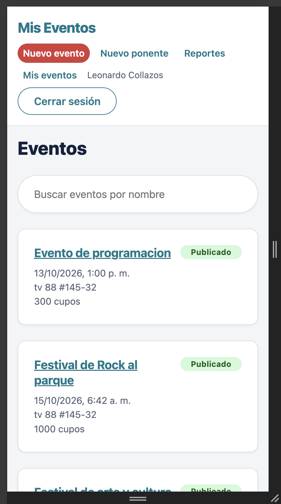

## Móvil: detalle del evento

**Ruta:** `/events/:id` en ancho de teléfono

El detalle del evento y la lista de sesiones en ancho de teléfono.

> 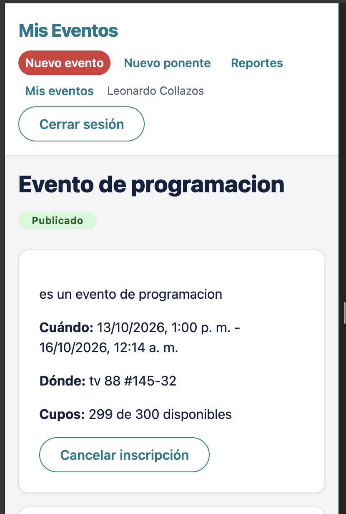
